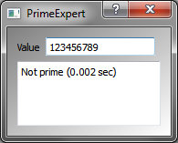

# PrimeExpert (VCL)

Determines if a number is prime.

PrimeExpert (VCL) is one of [Richèl Bilderbeek's tools](https://richelbilderbeek.github.io/tools/).

## Links

- [Source code](https://github.com/richelbilderbeek/PrimeExpertVcl)
- [Richèl Bilderbeek's tools](https://richelbilderbeek.github.io/tools/)
